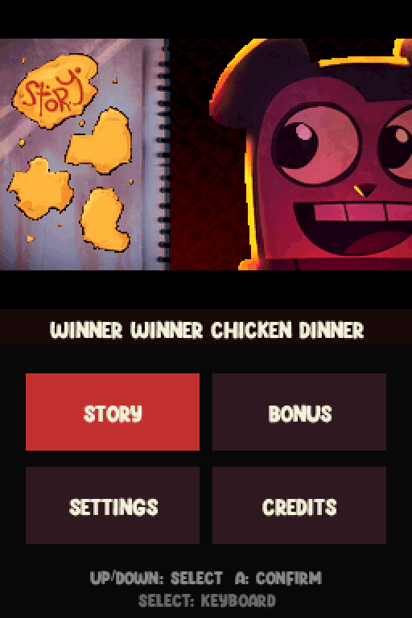
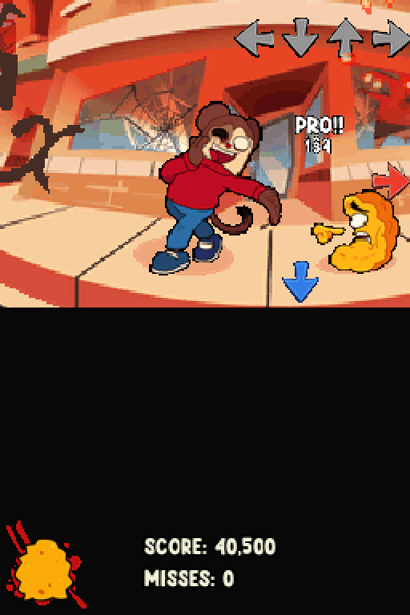
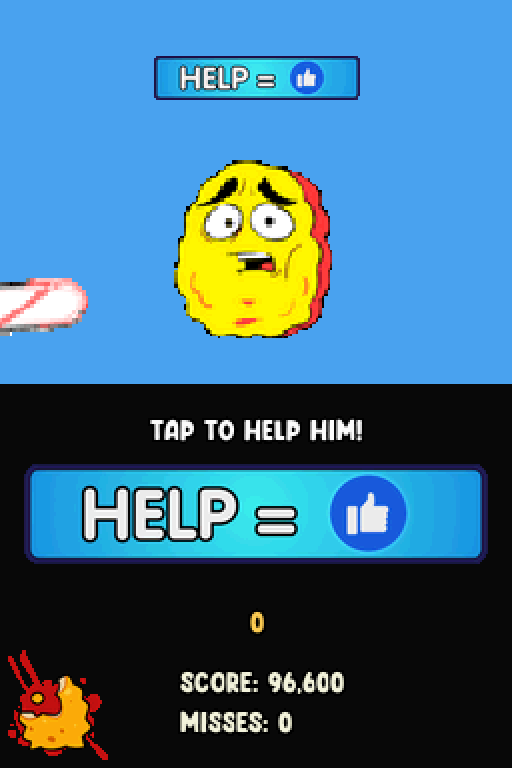
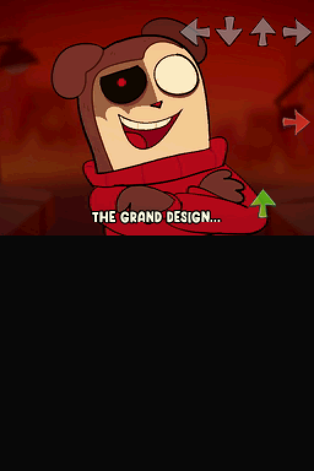
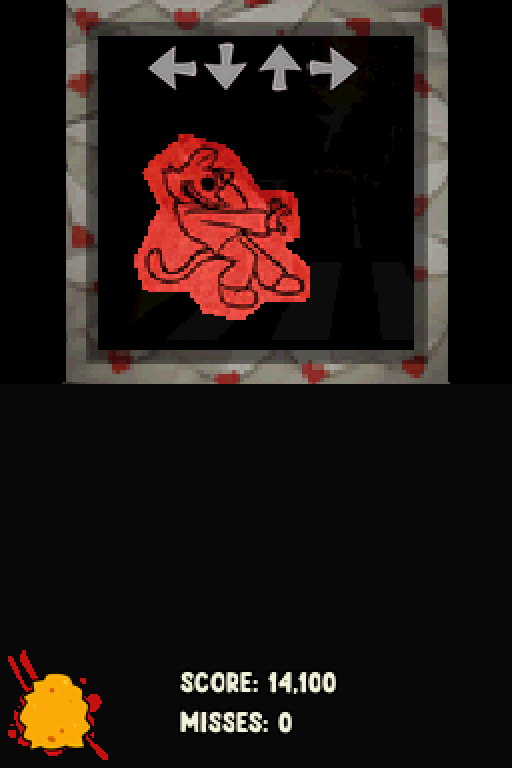

# One Last Bite DS

A Nintendo DS port of the Friday Night Funkin' mod **Winner Winner Chicken Dinner** ("ONE LAST BITE!", [GameBanana](https://gamebanana.com/mods/640444)), a fan-made Codename Engine mod based on [Twiddlefinger](https://github.com/RonyxDumb/twiddleDS).

Same approach as [twiddleDS](https://github.com/RonyxDumb/twiddleDS): this is not Codename Engine running on a DS. The game was rewritten in C with libnds, following the mod's HScript scripts and Codename Engine v1.0.1's PlayState / Character / Conductor behaviour, using the mod's original assets converted for the hardware.

| Menu | One Last Bite | HELP ME | Lyrics | To You |
| :---: | :---: | :---: | :---: | :---: |
|  |  |  |  |  |

A prebuilt ROM is in [`release/`](release) and on the [Releases](../../releases) page.

What is ported:

- **Intro** (Rainbow John Productions / Max Design Pro), **main menu** with the eye intro, the secret codes (`soccer`, `retro`, `bubby`) and credits, **story menu**, **bonus menu**, **options** (including the mod's options: lyric subtitles, reset progress, reset soccer scores), **pause menu** and the **"next up"** screen.
- **One Last Bite**: MDP "short" section (battery UI, watermark, MDP note skin, saturation shader), real youtubeland stage, character changes, the run cutscene with the **HELP ME** button (tap it at least 25 times for the good ending), both lyrics videos, red tint, both endings, the death video, health drain on opponent notes and the Codename camera / zoom events.
- **To You** (bonus song, unlocked after finishing One Last Bite): Abbey stage, heart intro, frame, animated borders, red notes, character change.
- **Soccer minigame** (type `soccer` in the main menu): skins, Normal / Super Fast modes, high score and most wins.

## Playing

Copy `WWCD_DS.nds` to your flashcart (TWiLight Menu++ / nds-bootstrap) or open it in **melonDS**. DeSmuME is not supported.

| Action | Buttons |
| --- | --- |
| Notes | D-pad or Y / B / X / A |
| Pause | START |
| Menus | D-pad, A / START = accept, B = back, or the touch screen |
| HELP ME button | tap it on the touch screen |
| Secret codes (main menu) | SELECT opens a touch keyboard |
| Soccer | UP / DOWN or drag on the touch screen |

Progress, high scores and options are saved to `/data/wwcdds.sav` on the SD card.

## Building

You need [devkitPro](https://devkitpro.org) with `nds-dev`, or Docker:

```sh
./build.sh      # builds WWCD_DS.nds using the devkitpro/devkitarm image
```

The converted assets are already in the repository. To regenerate them from the original mod (requires Python 3 with Pillow, ffmpeg and a C compiler), download the mod from GameBanana, extract it and get Codename Engine v1.0.1 (for the default sounds):

```sh
git clone --branch v1.0.1 https://github.com/CodenameCrew/CodenameEngine cne
python3 tools/convert.py path/to/1WWCD cne
python3 tools/videos.py path/to/1WWCD
```

## Project structure

```
source/          engine (gfx, audio, video, tweens), PlayState (play.c), song scripts
                 (olb.c, toyou.c), menus (menus.c) and the soccer minigame (soccer.c)
include/         headers
tools/           asset converters and a headless melonDS test frontend
nitrofiles/      converted assets packed into the ROM
maxmod_data/     sound effects
```

## Credits

All art, music, charts and videos belong to the creators of Winner Winner Chicken Dinner (Brayfruit, Borupen, EnzuPenzu, igpie, Sibottle, KATPizza, Esburger, Rain, Onyxium, Landelsoup, Az the Maz, Foxywuz, Amy), Twiddlefinger (MAXPROLOVER998), Max Design Pro and Friday Night Funkin'. This is an unofficial fan project.
